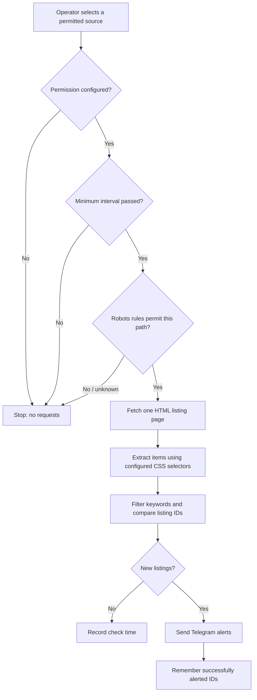

# 🏠 HousingyBot

### A configurable, permission-first public listing monitor


**Turn an authorized public listing page into targeted alerts, without manually refreshing it.**

HousingyBot began as a personal student-housing notification prototype. This version generalizes the same Python skills into a **configurable one-page monitor** for *websites that explicitly permit the proposed automated access*. There is **no built-in target website**, no automatic schedule, and no feature for evading access controls.

> [!IMPORTANT]
> **This is a technical compliance-oriented template, not legal clearance.** Public availability, a missing prohibition in terms, or an accessible `robots.txt` path do **not** establish legal permission. Operators must verify the website's applicable terms, relevant rights and laws, and permitted access frequency before configuring a live website. See [Responsible use](#responsible-use).

## Why build this?

Time-sensitive public listings—such as housing, event tickets, equipment rentals or job postings—can require repeated manual checking. HousingyBot illustrates a small monitoring pipeline: **fetch → parse → filter → compare with history → notify**. The tool focuses on engineering patterns instead of any specific commercial website.

## How it works



### Features

| Capability | Implementation |
|---|---|
| Website-agnostic parsing | CSS selectors defined in `config.json` |
| Explicit operator consent gate | Requires a permission confirmation and documented basis before fetching |
| Robots checks | Reads the source host's `robots.txt` and blocks disallowed paths |
| Conservative traffic | At most one listing-page request per execution, a 1-hour minimum interval, no automatic schedule |
| Narrow data collection | Only listing title, URL, optional price and location; up to 100 cards |
| Duplicate prevention | Locally hashed listing URLs stored in `seen.json` |
| Alert delivery | Telegram Bot API; mark a listing as seen only after a successful response |
| Offline testing | Seven unit tests using static HTML and mocks, no live scraping |

## Project structure

```text
housingybot/
├── .github/
│   └── workflows/
│       └── scrape.yml        # Manual execution only
├── tests/
│   └── test_scraper.py       # Offline tests
├── scraper.py               # Generic listing parser and notifier
├── config.example.json      # Non-operational configuration template
├── requirements.txt
├── seen.json                # Non-personal deduplication state
├── .gitignore
└── README.md
```

## Setup

### 1. Check authorization **before** configuring any live website

Prefer the site's documented **public API, RSS feed, export, or other approved automated interface** if available. Otherwise, check that automated requests to the precise page and at the intended rate are *expressly permitted* by written authorization or a published policy. Keep a reference to that authorization. If the site's terms are simply **silent**, do not treat that alone as approval.

The script requires either `written-permission` or `published-policy-explicitly-permits-automation`. These settings are *operator declarations*, not independent verification that permission exists.

### 2. Configure a permitted source

```bash
python -m pip install -r requirements.txt
cp config.example.json config.json
```

Open the ignored `config.json` and configure:

```json
{
  "website": {
    "listings_url": "https://your-approved-website.org/listings",
    "permission_confirmed": true,
    "permission_basis": "published-policy-explicitly-permits-automation",
    "permission_reference": "https://your-approved-website.org/automation-policy"
  },
  "selectors": {
    "item": ".listing-card",
    "title": ".listing-title",
    "link": "a.listing-link",
    "price": ".price",
    "location": ".location"
  },
  "filter_keywords": [],
  "minimum_interval_seconds": 3600
}
```

*The domains above are illustrative placeholders, not verified sources.* Replace the selectors with the actual site structure. `item`, `title` and `link` are required; `price` and `location` are optional. `filter_keywords` matches words in listing titles or locations (case-insensitive).

The sample `config.example.json` is intentionally **non-operational** (`permission_confirmed: false` and an example-only URL).

### 3. Preview an authorized page

```bash
python scraper.py --dry-run
```

This is **not an offline test**: it checks `robots.txt` and retrieves the configured public page, so permission is required. Preview mode does not send notifications or mark IDs seen, **but does record the check time to enforce the 1-hour minimum interval**.

For a fully offline demo with no website contact, run the test suite:

```bash
python -m unittest discover -s tests -v
```

### 4. Enable Telegram alerts

Obtain a bot token from Telegram's [BotFather](https://t.me/BotFather) and a destination chat ID. Keep both private.

```bash
export TELEGRAM_BOT_TOKEN="your-private-token"
export TELEGRAM_CHAT_ID="your-private-chat-id"
python scraper.py
```

On Windows PowerShell:

```powershell
$env:TELEGRAM_BOT_TOKEN = "your-private-token"
$env:TELEGRAM_CHAT_ID = "your-private-chat-id"
python scraper.py
```

The project makes no automated housing applications, purchases, or reservations. Notifications simply link to source listings.

## GitHub Actions (optional, manual only)

The `.github/workflows/scrape.yml` workflow has **no cron schedule**. To run it yourself, create three repository Actions secrets: `SITE_CONFIG_JSON` (the full private contents of your validated `config.json`), `TELEGRAM_BOT_TOKEN`, and `TELEGRAM_CHAT_ID`. Then trigger **Actions → Manual listing monitor → Run workflow**.

If the authorized check succeeds, GitHub Actions updates `seen.json` (a list of hashed, non-personal listing IDs and a timestamp) so duplicates and the minimum interval persist between manually triggered jobs. Never put tokens, cookies, personal information, or confidential permission documents in public repository files.

If you later introduce scheduling, independently confirm the site's allowed rate first. Do not lower the script's one-hour limit or enable frequent polling solely because GitHub Actions allows it.

## Responsible use

**Software safeguards cannot determine whether scraping a given website is lawful.** Before each use:

1. **Identify an affirmative basis for automation.** Review terms, API policies, any written permission, and local laws. Lack of an express ban is not an affirmative grant of rights.
2. **Respect `robots.txt`.** This program checks it, but the robots standard explicitly says robots instructions **are not access authorization** ([RFC 9309](https://www.rfc-editor.org/rfc/rfc9309)).
3. **Avoid protected or personal data.** Collect only necessary non-personal listing metadata. If a listing contains identifiable information, assess GDPR obligations before collecting it ([EDPB](https://www.edpb.europa.eu/topics/key-gdpr-concepts/legal-basis_en)).
4. **Respect database and copyright rights.** Even public factual collections may be subject to protections against systematic extraction ([EU Database Directive 96/9/EC](https://eur-lex.europa.eu/legal-content/EN/TXT/?uri=CELEX:31996L0009)). Avoid bulk copying and republishing source content.
5. **Don't bypass restrictions.** No CAPTCHA solving, credential scraping, proxy rotation, IP-block evasion, user-agent impersonation, or unauthorized authentication. Stop on HTTP 401/403/429, prohibited robots paths, unexpected redirects, or website objections.
6. **Minimize traffic.** Respect source-specific limits; the built-in one-hour floor is conservative, **not** a universal legal or technical safe harbor. Stop monitoring if the site asks you to.
7. **Preserve attribution and audit records.** Keep dated proof of permission privately, and review permissions when site rules change.

This template does **not** guarantee compliance with all contracts, laws, or regulatory regimes, and should not be construed as legal advice. If permission is ambiguous, request clarification from the website operator or use its official API.

## Limitations

- Handles **one static HTML page per check**, not JavaScript-only listings, logins, pagination, or arbitrary APIs.
- CSS selectors must be adapted when a site's markup changes; it may report zero listings when selectors stop matching.
- Telegram notification delivery can fail; failures stop processing and unconfirmed listings are not marked seen.
- Permission checks are **declarations made by the operator**, not automated legal or terms-of-service verification.
- The historical GitHub commit history may still contain code from the earlier housing-specific prototype; this refactor does **not** retroactively change that history.

## Background & author

Developed by **Badr El Jaouhari** as a personal Python automation project, originally motivated by difficulty tracking time-sensitive student accommodation. The generalized version demonstrates responsible automation design, HTML parsing, configuration-driven extraction, request limiting, state management, Telegram integration, and offline testing.

**Not affiliated with or endorsed by any listing platform.**